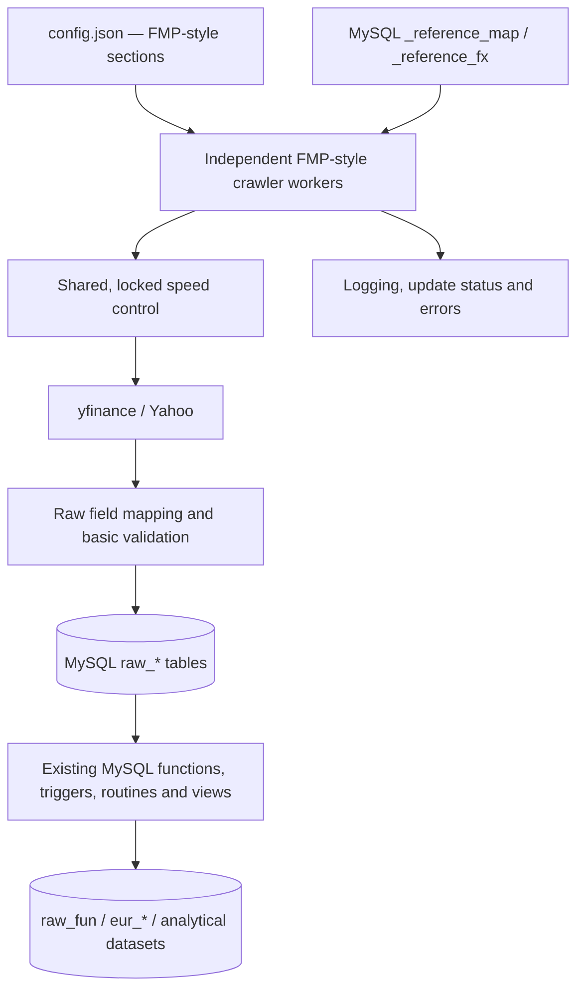

# FIN Yahoo Crawler — Technical Concept

**Revision:** 2 — FMP-compatible configuration and raw-data-only crawler  
**Date:** 2026-10-30  
**Target:** Python + `yfinance` + MySQL 8  
**Primary reference:** `docs/fin_fmp_crawler.zip`  
**Secondary reference:** `docs/time-controlled-payload-framework.zip` (speed-control mechanism only)  
**Status:** Implementation concept; not a claim that the Yahoo crawler has already been implemented or tested end-to-end.

## 1. Executive decision — scope and priorities

Build a Yahoo Finance data crawler which **replaces FMP as a source of raw data** while preserving the operational conventions and database integration of the existing `fin_fmp_crawler`.

**Priority order:**

1. **FMP crawler is the architectural and configuration baseline.** Reuse its `config.json` structure as much as possible, worker purposes, MySQL table mappings, `_reference_*` selections, refresh logic and commands where practical.
2. **Acquire and persist raw source data.** The Python application retrieves Yahoo data through `yfinance`, maps source field names to the existing raw-table contracts, validates basic types, and performs idempotent database writes.
3. **Keep financial logic in MySQL.** Currency conversion, EPS/DPS/CPS/BPS, valuation ratios, aggregations and other analytical transformations belong to the **existing database layer**, not the Python crawler.
4. **Adapt only the speed-control implementation** from `time-controlled-payload-framework.zip`; do **not** adopt its unrelated `global`/`jobs[]` configuration model or demo job architecture.
5. **Minimize change to existing consumers.** Prefer the FMP database schema and raw table names, subject to verifying the actual deployed schema. Do not create a competing financial model or parallel EUR-processing pipeline.

### Explicit boundary

| Responsibility | Python Yahoo crawler | MySQL / downstream SQL |
|---|---|---|
| Request Yahoo data through `yfinance` | **Yes** | No |
| Control request rate, retries and scheduling | **Yes** | No |
| Select assets from `_reference_map` and `_reference_fx` | **Yes** | Stores selection flags |
| Map Yahoo labels to existing raw column names | **Yes** | No |
| Preserve source values, currencies, period labels and timestamps | **Yes** | Stores them |
| Insert/upsert `raw_*` tables | **Yes** | Persists and indexes |
| Fetch raw FX series such as `EURUSD=X` | **Yes** | Stores raw rates |
| Convert prices or financial values into EUR | **No** | **Yes** |
| Calculate EPS, DPS, CPS, BPS, P/E, P/B or profit ratios | **No** | **Yes**, if required |
| Join income/balance/cash-flow data into `raw_fun` | **No** | **Yes** |
| Update `eur_*` tables, materialized data or analytical views | **No** | **Yes** |
| Apply FX carry-forward / revisions / subunit conversions | **No** | **Yes** |
| Build DCF models or investment signals | **No** | Separate consumers |

**Raw does not mean storing anonymous JSON only.** It means persisting *source-reported values* without business calculations. Structural formatting (date parsing, casting, `NaN` → SQL `NULL`, field-name mapping, provenance and identifying the source currency) is permitted; conversion, per-share computation, ratio calculation or manufacturing unavailable values is not.

## 2. Verified behavior of the reference projects

### 2.1 `fin_fmp_crawler.zip` — authoritative pattern

The archived repository contains a top-level `config.json` with the following shape:

```text
fmp
├── database
│   ├── host, port, schema, user, password
│   └── tables
│       ├── reference_fx, reference_map, symbolslist, companykeystats
│       ├── income, cashflow, balance
│       └── fx, quote, quote_eps
├── connection
│   ├── api_key (FMP-specific)
│   └── speed (queries per minute)
├── file
│   ├── log, debug, speed_control
├── control
│   ├── update_companykeystats_delay
│   ├── update_statement_delay
│   ├── update_statement_all
│   ├── update_stream_delay
│   ├── update_symbolslist_delay
│   └── update_timeserie_delay
└── debug
```

The implementation selects database tables with `CONFIG["database"]["tables"][...]`, reads symbols from the reference tables, and runs separate entry-point scripts for each type of download. The `control.*_delay` values are **post-run sleeps**, whereas `connection.speed` controls request pacing; they are not interchangeable.

| Reference Python entry point | Reference behavior | Yahoo counterpart |
|---|---|---|
| `update_symbolslist.py` | Load stock/ETF instrument universe | Maintain/import the available symbol universe; Yahoo offers no identical complete market-list endpoint |
| `update_companykeystats.py` | Update stale company profiles | Fetch `Ticker.info`/other available source metadata and upsert raw profile columns |
| `update_statement.py income\|cashflow\|balance` | Annual fundamentals for mapped symbols, or all if configured | Fetch Yahoo source statements by type and store available source values |
| `update_timeserie.py` | Long historical backfill or rolling 30-day quote/FX update | Fetch native-currency daily history and native Yahoo FX-pair quotes |
| `update_stream.py` | Periodic quote and FX snapshots controlled by `stream` flags | Periodic Yahoo polling, not a guaranteed real-time stream |
| `mylib/fmp_db.py` | SQLAlchemy/MySQL upsert utilities | Adapt for robust raw-only writes, not a new analytical engine |
| `mylib/yahoo_service.py` | Partial existing yfinance implementation | Starting prototype; requires correctness and error-handling fixes |
| `src/mysql/*` | Raw/derived tables, generated columns, triggers and SQL routines | **Keep database logic in SQL**, review compatibility separately |

**Database evidence:** `src/mysql/raw_fun.sql` creates generated columns for `eps`, `dps`, `cps`, `bps` and has triggers writing to `eur_fun`; `src/mysql/trigger_raw_ts_quote_eps.sql` writes EUR prices to `eur_ts_quote`. This confirms that Python should **not** duplicate those calculations.

**Compatibility warning:** The archived SQL is *not* a complete consistent fresh-install migration. Some scripts use older `fmg` names, while the archived config uses `fmp` and `raw_*` tables. Validate the **real target database** before assuming an SQL object exists or is correct. Preserve database responsibilities; do not blindly install old triggers.

### 2.2 `time-controlled-payload-framework.zip` — narrowly scoped reuse

Reuse the following concepts from `src/python/common/throttle.py`:

- `throttle_file_rw`: persistent state containing `next_allowed_at`.
- `timing_logic`: calculate spacing from configured operations per minute.
- `throttle`: reserve the next permitted operation and wait when required.

**Necessary correction:** The reference implementation reads and updates the shared state without a process lock. Multiple crawler containers can reserve the same slot. Implement locked, atomic reservation, shared cooldown, bounded error recovery and tests. Its `config/config.json` `global`/`jobs[]`, `executions`, `delay_seconds` and sample job types **do not become the Yahoo crawler's main configuration**.

## 3. Target architecture



### Responsibilities, in execution order

1. Read `config.json` in the **FMP-compatible structure**; resolve DB settings, table names, file paths and selected worker settings.
2. Read due symbols or currencies from existing MySQL reference/work tables.
3. Reserve a shared throttle slot before invoking a potentially remote yfinance operation.
4. Retrieve Yahoo data, preserving the original value and unit/currency.
5. Map to the raw destination table using an explicit source-field mapping.
6. Validate basic identity and representation: symbol, date/period, numeric type, available currency, nonfinite values and unique key.
7. Upsert raw source records transactionally; report partial or missing data without inventing substitutes.
8. Mark a backfill or refresh successful **only after the corresponding SQL write commits**.
9. Finish the run and apply `control.*_delay` as in the FMP lifecycle. Existing MySQL logic then performs independent transformations when data is available.

**Not part of this pipeline:** a Python `convert_to_eur()`, `calculate_eps()`, `calculate_per()`, `build_eur_fun()`, `materialize_ratios()` or analogous derived-value function.

## 4. `config.json` — inherit the FMP schema

This is the primary correction to the previous concept: **do not use a new `global`/`jobs[]` configuration layout.**

Maintain the exact **organizational structure** of `fin_fmp_crawler/config.json`. The top-level provider key is renamed from `fmp` to `yahoo` to identify the new service; the nested names stay familiar. Remove the now-unused `api_key`. Add only a few explicitly documented Yahoo/reliability options.

### 4.1 Proposed `config.json`

```json
{
  "yahoo": {
    "database": {
      "host": "127.0.0.1",
      "port": "3309",
      "schema": "fmp",
      "user": "fmp",
      "password": "${MYSQL_PASSWORD}",
      "tables": {
        "reference_fx": "_reference_fx",
        "reference_map": "_reference_map",
        "symbolslist": "raw_assetslist",
        "companykeystats": "raw_companykeystats",
        "income": "raw_fun_income",
        "cashflow": "raw_fun_cashflow",
        "balance": "raw_fun_balance",
        "fx": "raw_ts_fx",
        "quote": "raw_ts_quote",
        "quote_eps": "raw_ts_quote_eps"
      }
    },
    "connection": {
      "speed": 10,
      "timeout_seconds": 20,
      "max_attempts": 3,
      "cooldown_seconds_on_rate_limit": 300
    },
    "file": {
      "log": "./yahoo_crawler.log",
      "debug": "./yahoo_debug.log",
      "speed_control": "./yahoo_speed.json"
    },
    "control": {
      "update_companykeystats_delay": 0.0,
      "update_statement_delay": 0.0,
      "update_statement_all": false,
      "update_stream_delay": 3600.0,
      "update_symbolslist_delay": 43200.0,
      "update_timeserie_delay": 10800.0,
      "history_overlap_days": 30,
      "statement_frequency": "annual"
    },
    "debug": false
  }
}
```

**Example, not an executable config.** `${MYSQL_PASSWORD}` represents an **explicit application-side environment-variable substitution to implement**; standard `json.load()` does not expand it. Alternatively allow the database password to be supplied by a documented environment override. Do not commit actual passwords or provider response logs. `schema: "fmp"`, port and account are legacy-oriented examples; configure for the actual deployment.

The delay and speed values shown reproduce the archived FMP settings where applicable; they are **reference values**, not independently verified safe Yahoo quotas. The added timeout/retry/cooldown defaults are proposed rather than copied from FMP.

### 4.2 Compatibility requirements

| FMP configuration path | Yahoo configuration path | Policy |
|---|---|---|
| `fmp.database.host/port/schema/user/password` | `yahoo.database.*` | Same keys and meanings |
| `fmp.database.tables.*` | `yahoo.database.tables.*` | **Same logical keys and, by default, same raw table names** |
| `fmp.connection.speed` | `yahoo.connection.speed` | Positive numerical maximum provider operations/minute |
| `fmp.connection.api_key` | **Omitted** | yfinance needs no FMP API key |
| `fmp.file.log/debug/speed_control` | `yahoo.file.*` | Same file roles; throttle state format may be JSON |
| `fmp.control.update_*_delay` | `yahoo.control.update_*_delay` | Same per-worker post-run delays |
| `fmp.control.update_statement_all` | `yahoo.control.update_statement_all` | Same all-vs-mapped fundamental universe selection |
| `fmp.debug` | `yahoo.debug` | Same boolean logging intention |

**New keys must be optional, documented and backward-compatible with the FMP-style reader**, never require a config restructuring. `statement_frequency` defaults to `annual` until quarterly storage uniqueness is reviewed. A later `quarterly` or `both` mode is an extension, not an implicit change to raw tables.

**Do not include** `global`, `jobs[]`, a separate `database.url_env` object, a `base_currency` controlling crawler conversion, EUR conversion settings, financial-formula settings or generic `data_policy` trees in the mandatory configuration.

### 4.3 Table names are configuration, not constants

Every SQL worker should resolve table names from `CONFIG["database"]["tables"]`, as the FMP scripts do. Use an allowlist/identifier validation before interpolating table identifiers into SQL; bind **values** as SQL parameters. Schema migrations belong to database deployment, not to normal crawler startup.

## 5. Raw dataset acquisition and FMP table mapping

### 5.1 Sources and destination tables

| Data | yfinance source (conceptual) | Destination from `database.tables` | Important behavior |
|---|---|---|---|
| Instrument universe | Existing `_reference_*`, imported stock/ETF list or maintained watchlist | `raw_assetslist` | Yahoo does **not** have a verified equivalent of FMP's complete stock/ETF-list endpoint |
| Profile/key stats | `Ticker.info`; selected `fast_info` values | `raw_companykeystats` | Store only provider fields actually available; keep unsupported FMP fields `NULL` |
| Annual income | `Ticker` income-statement data | `raw_fun_income` | Map source rows to FMP raw columns, no computed margins |
| Annual balance | `Ticker` balance-sheet data | `raw_fun_balance` | No computed book value, gearing or net debt |
| Annual cash flow | `Ticker` cash-flow data | `raw_fun_cashflow` | Preserve source signs and units; no per-share dividend calculation |
| Daily quote history | `Ticker.history` or `yf.download` with explicit `auto_adjust=False` | `raw_ts_quote` | Store source-currency OHLCV and any available raw adjustment fields |
| Latest quote/available EPS | `Ticker.info`, `fast_info`, last market bar where suitable | `raw_ts_quote_eps` | EPS only if source-provided; no Python P/E or EPS estimate |
| Historical FX | Yahoo FX symbol, e.g. `EURUSD=X` | `raw_ts_fx` | Store raw pair rate and its documented direction, not converted asset prices |
| Latest FX | Yahoo FX last available observation | `raw_ts_fx` | Same source convention as historical FX; refresh on configured schedule |

The worker must not infer absent historical FMP features from live Yahoo values. No silent synthetic history, no fabricated periods, no replacement of missing source data with zero.

### 5.2 Existing raw table contract — preserve first

The archived `config.json` names the following raw destinations exactly:

```text
raw_assetslist        raw_companykeystats
raw_fun_income        raw_fun_cashflow        raw_fun_balance
raw_ts_fx             raw_ts_quote           raw_ts_quote_eps
```

It also names the two selectors:

```text
_reference_fx         _reference_map
```

**Do not rename these or introduce a fresh `fin_yahoo` schema by default.** The initial approach is a Yahoo ingestion service that can write to the same raw-data contract. Compatibility is determined by inspecting the deployed tables' actual definitions and preserving columns used by existing SQL logic.

Important FMP raw statement fields to map *when actually available*: `date`, `symbol`, `reportedCurrency`, `calendarYear`, `period`, `netIncome`, `weightedAverageShsOut`, `revenue`, `grossProfit`, `researchAndDevelopmentExpenses`, `operatingCashFlow`, `dividendsPaid`, `totalStockholdersEquity`, `preferredStock` and other database-supported raw inputs.

- The source library's financial rows may use different names across companies. Maintain a **declarative source-label → raw-column mapping** with fixture-based validation.
- `reportedCurrency` comes from a verified Yahoo source; it is not automatically equal to the listed security's trading currency. Store unknown currency as unavailable, do not invent EUR/USD.
- Only assign `calendarYear`/`period` labels when the source period is known; fiscal year end and calendar year are not necessarily the same concept. Keep quarterly and yearly results separate.
- Preserve provider values, including genuine zero and negative cash-flow signs. Do not use `a or b` for numeric fallbacks, silently change `dividendsPaid` sign, or compute `grossProfitRatio = grossProfit/revenue` in Python. If the downstream schema requires a value that Yahoo does not report, leave it `NULL` and let SQL handle it.
- Do not populate `raw_fun` directly from Python; it is an existing **SQL-derived** dataset with stored generated columns and triggers. If the deployed SQL requires updating, that is an explicit database task, separate from this crawler.

### 5.3 FX is raw ingestion; currency conversion is SQL

The FMP reference queries the pair `EUR` + currency (for example, EUR/USD), storing the rate in `raw_ts_fx` under the currency identifier (`USD`) and the record's `currency = 'EUR'`. The quoted price represents **quote-currency units per EUR**, not EUR per quoted unit. The archived `raw_fun` SQL divides financial values by the corresponding EUR FX rate.

For Yahoo, implement an explicit pair mapping, for example:

```text
_reference_fx.symbol = USD  →  Yahoo ticker EURUSD=X
Yahoo returned closing rate →  raw_ts_fx.close
raw_ts_fx.symbol = USD
raw_ts_fx.currency = EUR
```

This is **identifier/field mapping**, not a currency conversion. The Python crawler must store the observed `EURUSD=X` source rate as received, after verifying pair orientation. Do not use it to transform a USD-denominated stock price into EUR in Python.

**The database layer is responsible for:**

- USD/GBP/other source currency → EUR using the applicable raw FX series.
- Trading subunits, such as `GBp` versus `GBP`, where required by the deployed SQL contract.
- Matching valuation dates to available FX observations, weekend/holiday gaps and rate freshness.
- Rebuilding EUR-derived data when historical FX or raw fundamentals change.
- Rejecting missing rates rather than silently treating them as `1` (except actual EUR/EUR).

**Existing SQL must be reviewed independently.** For example, the legacy `raw_fun` trigger contains GBp handling and its correctness depends on the actual source units; the archived `eur_fun` table is keyed by `(date, symbol)`, which may not distinguish multiple periods. These are **database-layer issues**, not reasons to add calculations to the crawler.

### 5.4 Prices, periods and actions

- Request unadjusted price history explicitly (`auto_adjust=False`) so OHLC remains in source trading units. Store any reported adjusted-close/dividends/splits separately only if the deployed schema supports them; otherwise propose a minimal **raw-only** extension.
- Do not overwrite unadjusted history with adjusted close or back-adjust manually in Python.
- Use explicit trade-date/timezone handling. Store original observation time where available; a fetch timestamp is not an exchange quote timestamp.
- Historical annual/quarterly statement dates are period-end dates, **not** download dates. Do not merge FY and Q4 for the same date without a reviewed unique key.
- `raw_ts_quote_eps` keeps the FMP table name, but should not receive a synthetic EPS value when Yahoo lacks a reported metric. If existing SQL requires EPS, record the gap.

## 6. Reference-table-driven work selection

Match `fin_fmp_crawler` selection semantics rather than inventing a new job-discovery/configuration system.

### `_reference_map`

- `symbol` is the ticker used for market price history and quote updates.
- `symbol_fundamental` is the symbol used to retrieve fundamentals when it differs from the price ticker.
- `currency` identifies the instrument's **trading** currency; this does not by itself establish the reported financial-statement currency.
- `longTimeSerie = true` requests initial full price history; clear it **only after successful and sufficiently complete persistence**.
- `stream = true` includes the instrument in periodic quote polling.

### `_reference_fx`

- `symbol` identifies the FX quote currency relative to the legacy EUR base, e.g. `USD`.
- `longTimeSerie = true` requests historical FX backfill; clear only on successful persistence.
- `stream = true` includes the currency in quote polling.

### Fundamental selection

- `control.update_statement_all = false`: use `symbol_fundamental` from `_reference_map` (as in the FMP script).
- `control.update_statement_all = true`: select eligible symbols from the profile/raw universe (as in the FMP script).
- Profiles: update eligible stale/missing companies using the existing company key-stats table and its `updated` logic where available.
- Symbol list: maintain the instrument universe from existing data or import sources. Do **not** claim yfinance supplies an equivalent `stock_list`/`etf_list` endpoint.

The application must support resumption after an interruption. Use existing durable DB work/reference fields where adequate; add a **minimal ingestion-status table** only if needed for retries, failures or bounded backfills. Do not require a new job-run schema for raw ingestion unless the existing DB cannot satisfy correctness.

## 7. Worker structure and execution

Keep the existing FMP-style entry points (or backward-compatible CLI equivalents):

```bash
python src/python/update_symbolslist.py
python src/python/update_companykeystats.py
python src/python/update_statement.py income
python src/python/update_statement.py cashflow
python src/python/update_statement.py balance
python src/python/update_timeserie.py
python src/python/update_stream.py
```

Paths are the proposed implementation entry points, mirroring the reference archive; they are **not** commands currently implemented in the Yahoo repository.

| Worker | Input and processing | Output |
|---|---|---|
| Symbols | Existing symbol universe/import; de-duplicate and validate | `raw_assetslist` / reference-list maintenance |
| Company profiles | Due profile symbols, refresh source metadata | `raw_companykeystats` |
| Statements | Existing selection, fetch source-reported annual fields; optional quarterly after database key review | `raw_fun_income`, `raw_fun_cashflow`, `raw_fun_balance` |
| Time series | `_reference_map` / `_reference_fx`, backfill or rolling overlap | `raw_ts_quote`, `raw_ts_fx` |
| Stream/poll | `stream=true` rows from both reference tables | `raw_ts_quote_eps`, `raw_ts_fx` |

### Backfill/update policy

1. On `longTimeSerie=true`, request the longest available Yahoo daily history in bounded windows as supported by the provider; persist it in source currency.
2. Confirm successful storage before switching `longTimeSerie` to false.
3. Subsequent runs download a configurable rolling overlap (default **30 days**, reflecting FMP behavior), and upsert rows by their natural key.
4. A missing, empty, incomplete or rate-limited Yahoo response **must not** clear `longTimeSerie` or replace valid stored rows with `NULL`.
5. Treat `update_stream` as scheduled **polling**, not exchange-grade real-time streaming.
6. Honor each FMP-style `control.update_*_delay` after the worker run, separately from provider rate control.
7. Keep SQL upserts idempotent; period revisions should update raw values while preserving traceability and allowing SQL-derived tables to refresh.

## 8. Speed control — framework algorithm, FMP configuration

This is the **only** area where `time-controlled-payload-framework.zip` takes design precedence over the old FMP implementation.

### Configuration and semantics

```text
CONFIG["connection"]["speed"]       -> operations / minute
CONFIG["file"]["speed_control"]     -> shared persistent throttle state
CONFIG["control"][...delay]          -> worker recurrence delay (unchanged)
```

At `speed = 10`, the intended **minimum average spacing** is `60 / 10 = 6` seconds between reservations. This is a configurable *application-level pacing policy*, **not** a claim that Yahoo allows ten HTTP requests a minute. A single `yfinance` operation may internally issue multiple HTTP requests, so internal Yahoo traffic cannot be guaranteed by a throttle wrapped only around high-level calls.

### Required algorithm

1. Every worker shares one throttle state and lock file on its host (and mounted volume if Docker is used).
2. Acquire an exclusive **cross-process lock** before reading/updating throttle state.
3. Reserve a unique next execution slot using `next_allowed_at = max(now, previous_next_allowed_at) + 60/speed` and compute the current operation's wait interval under the lock.
4. Persist the updated state atomically; release the lock **before** waiting or making a Yahoo request.
5. Wait until the reserved slot; execute the provider operation.
6. On throttling/HTTP 429, apply a **shared cooldown**, bounded backoff and retry with an explicit attempt limit.
7. When the throttle file is missing or malformed, recover deterministically with a logged warning and safe default; never permit simultaneous workers to reset and bypass each other's pacing.

One state volume is sufficient for a **single host**. File locking across independent hosts/network filesystems is not guaranteed without testing; multi-host operation requires a centralized reservation mechanism (for example, a dedicated MySQL lease/rate table).

## 9. Database contract and separation of ownership

### 9.1 Ownership

The Yahoo crawler is a **writer to raw tables** and **reader of reference/work-selection tables**. The SQL layer owns everything derived:

```text
                 yfinance
                     |
             [Python crawler]
                     |
                 raw_* data
                     |
           [existing MySQL SQL]
                /          \
            raw_fun       eur_*
                \          /
             analytic views
```

The archived schema contains `raw_fun`, `eur_fun`, `eur_ts_quote` and `eur_ts_fx` outside the raw destination list in `config.json`. These are **database-managed objects**, not Yahoo worker outputs. Keep existing triggers, scheduled events or stored routines as the authoritative owners after verifying the actual deployed installation.

### 9.2 Required raw persistence properties

- Deterministic upserts using the table's actual unique key (e.g. `symbol` for profiles; `date, symbol` for daily bars; statement identity must also account for reporting currency and period where supported).
- Preserve values in source/reporting/trading currency; do not run exchange-rate lookups before inserting statements or prices.
- Use SQL `NULL` for unavailable Yahoo fields, but **do not overwrite a previously valid value with unavailable data during a partial refresh** without a deliberate replacement policy.
- Write meaningful source/provenance and fetch timestamps where the schema allows; any added columns must remain backward compatible.
- Commit each bounded batch; leave failed work eligible for retry and never report success for a failed SQL write.
- Detect and report schema incompatibilities rather than silently modifying existing DB triggers, keys or definitions.
- Record full provider failures and missing mappings without printing credentials or unbounded payloads.

### 9.3 Known database-specific checks before deployment

1. Verify the deployed `raw_*`, `_reference_*`, `raw_fun` and `eur_*` tables, columns, triggers, generated columns, unique keys and event scheduler status.
2. Confirm `raw_ts_fx` stores the same oriented rate that the existing SQL formulas expect (`EURXXX`: units of XXX per EUR), including dates and currency identifiers.
3. Confirm all data and historical FX arrive before SQL reconciliation, or that SQL handles late-arriving rates and revisions.
4. Confirm pence versus pounds and other trading-unit conventions are treated consistently by the SQL layer.
5. Check how quarterly versus annual statement identity is handled before enabling quarterly ingestion. The archive's examples do **not** prove that the currently deployed raw tables can store both without collisions.
6. Review the SQL ratios and trigger conditions as independent database tasks. **Do not repair their behavior by duplicating financial transformations in Python.**

## 10. Python package plan — deliberately small

```text
fin_yahoo_crawler/
├── config.json                         # FMP-shaped Yahoo config
├── src/python/
│   ├── update_symbolslist.py
│   ├── update_companykeystats.py
│   ├── update_statement.py
│   ├── update_timeserie.py
│   ├── update_stream.py
│   └── mylib/
│       ├── config.py                   # Load/validate FMP-shaped config
│       ├── yahoo_service.py            # All yfinance calls, no SQL derivation
│       ├── yahoo_mapping.py            # Source fields -> raw SQL columns
│       ├── yahoo_throttle.py           # Shared locked speed control
│       ├── yahoo_db.py                 # Raw upserts and reference queries
│       └── write_log.py                # Operational logging
├── tests/
│   ├── test_config.py
│   ├── test_mapping.py
│   ├── test_throttle.py
│   ├── test_worker_selection.py
│   └── test_raw_db_integration.py
├── docs/
│   ├── fin_fmp_crawler.zip
│   └── time-controlled-payload-framework.zip
├── requirements.txt
├── docker-compose.yml
└── concept.md
```

This is a **proposed** layout. Reuse existing FMP module names/interfaces when helpful rather than adding new abstractions or a generic multi-provider processing framework.

### `yahoo_service.py` requirements

- No network call at import time (remove the reference module's trailing test call).
- Centralize `yfinance` access, configure known call parameters and preserve original source data values.
- Handle empty DataFrames, missing fields, unexpected multi-index results, network errors, Yahoo throttling, unavailable instruments and malformed responses explicitly.
- Never return `[{}]` as a disguised successful response; differentiate `no_data`, `retryable_error`, `permanent_error` and `success`.
- Make zero-safe mapping (`0` is data, not an automatic fallback), proper `NaN`/`None` handling and typed dates.
- Use provider fixtures in unit tests; live Yahoo tests are opt-in and cannot establish universal field completeness.

### Dependencies and deployment

Use a supported Python version, `yfinance`, pandas where required, SQLAlchemy and a maintained MySQL driver, plus a small cross-process lock implementation. Pin and test actual dependency versions in implementation. Prefer Docker Compose on Debian, with a shared mounted throttle file, existing MySQL networking and the existing independent worker deployment pattern. Local macOS execution should remain possible.

## 11. Acceptance criteria — measurable, raw-data-focused

| Check | Acceptance result |
|---|---|
| Configuration shape | **Pass** only if config uses top-level `yahoo` with FMP-style `database`, `connection`, `file`, `control`, `debug`; no `global`/`jobs[]` required |
| Table mappings | **Pass** only if workers resolve all raw and reference tables from `database.tables` |
| Raw price sample | For a chosen equity, Yahoo source-currency OHLCV stored unchanged, except representation and field-name formatting |
| Raw statement sample | Source income, balance and cash-flow values preserved; missing values remain missing; no Python EPS/DPS/CPS/BPS calculation |
| FX sample | `EURUSD=X` source close recorded as raw FX with validated EUR→USD direction, with **no Python EUR conversion** |
| SQL-only financial derivation | No Python routine creates or writes `raw_fun`, `eur_fun`, `eur_ts_quote` or other derived datasets |
| Reference flags | `symbol_fundamental`, `update_statement_all`, `longTimeSerie`, `stream` behave like FMP semantics |
| Incremental history | Initial backfill, subsequent 30-day overlap, idempotent writes and safe retry after interruption work |
| Speed control | Multiple processes never reserve the same throttle slot; configurable `connection.speed`; restart recovery and 429 cooldown tested |
| Missing provider data | Unsupported Yahoo fields are logged or `NULL`, not fabricated, and do not corrupt last good observations |
| Database compatibility | Existing SQL transformations and downstream queries continue functioning against the intended raw table contract in a controlled integration test |
| Deployment | FMP-style worker scripts run locally and in Docker with one shared config and throttle state |

**Verification approach:** offline provider fixtures and MySQL integration tests are required. A live Yahoo smoke test for selected symbols/FX pairs is separate because response coverage and rate limiting vary. Test the SQL behavior in a database copy without altering production financial results.

## 12. Delivery order

| Phase | Scope | Exit condition |
|---|---|---|
| **P0 — Compatibility baseline** | Inspect actual MySQL schema, FMP config, selection flags and raw SQL contracts | Exact raw destination and reference table mapping documented |
| **P1 — Minimal Yahoo foundation** | FMP-shaped `config.json`, logging, raw DB adapter, yfinance source adapter, reliable shared throttle | Config/throttle tests pass, safe source fixture read/write |
| **P2 — Raw market data** | Quote history, FX history, periodic quote polling and incremental backfill | Native prices and FX land in `raw_ts_quote`, `raw_ts_fx`, `raw_ts_quote_eps` |
| **P3 — Raw fundamentals** | Profiles plus annual income, cash flow and balance sheet; missing field reporting | Source fundamental values land in existing `raw_*` tables |
| **P4 — DB integration check** | Exercise **existing MySQL-owned** `raw_fun`/`eur_*` downstream SQL on a controlled DB | EUR outputs reconcile without any crawler-side financial calculations |
| **P5 — Coverage extensions** | Additional metadata, quarterly ingestion after key/schema review, optional raw dividends/splits | No regression of baseline raw contract |

There is **no phase to implement a second Python EUR-conversion engine or a second Python metric-calculation engine**.

## 13. Risks, unknowns and non-goals

| Item | Assessment | Handling |
|---|---|---|
| Yahoo data-field coverage differs from FMP | **High confidence** | Report unsupported/missing fields, preserve raw values, do not synthesize data |
| Yahoo full stock/ETF symbol universe parity | **Not established** | Use existing DB reference universe or documented imports |
| Yahoo internal HTTP requests per `yfinance` call | **Unknown** | Throttle high-level operations, measure real behavior, use shared 429 cooldown |
| Historical fundamental depth and completeness | **Variable / not guaranteed** | Store all available source periods; never promise five annual years or three quarterlies |
| Actual deployed MySQL schema/triggers | **Unknown** from archived files alone | Inspect DB before implementing compatibility, especially FX/period handling |
| Correctness of legacy SQL for all currencies | **Not established** | Test and fix in SQL independently; never hide defects with Python calculations |
| Use of Yahoo finance data | **Provider-dependent** | Respect applicable service restrictions; use with appropriate access rights |

### Explicit non-goals

No new generic job framework, no mandatory migration to a fresh schema, no Python FX conversion, no Python ratio calculation, no Python SQL-derived-table writer, no DCF model, no guaranteed live-stream market feed and no claim of complete FMP/Yahoo data equivalence.

### Source hierarchy and confidence

- **High:** Existing FMP config keys, worker selection, control settings, raw destinations and archived SQL-generated EPS/DPS/CPS/BPS plus EUR triggers — inspected in `docs/fin_fmp_crawler.zip`.
- **High:** Throttle mechanism and missing process lock — inspected in `docs/time-controlled-payload-framework.zip`.
- **Moderate:** Proposed Yahoo mapping and workflow feasibility — based on archived `mylib/yahoo_service.py`, subject to runtime and fixture tests.
- **Unknown:** Exact deployed MySQL schema, the reliability of Yahoo responses for each symbol, provider limits and overall data coverage until measured.

**Design rule:** **FMP determines configuration and database contracts. Yahoo/yfinance supplies raw data. The timing framework supplies only improved speed control. MySQL performs currency conversion and financial calculations.**
